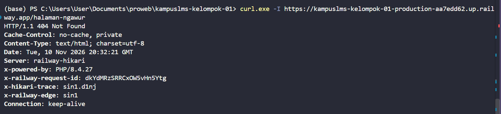
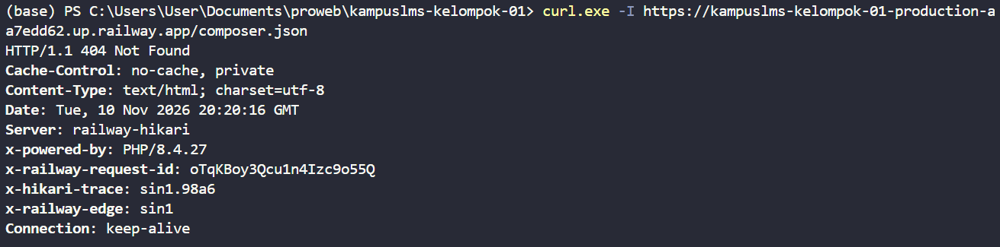
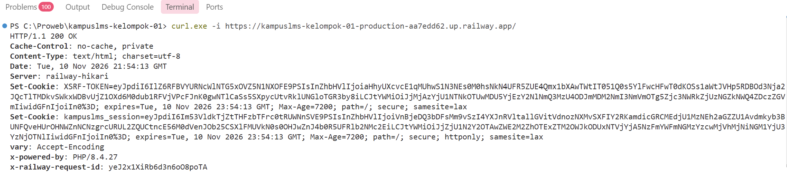
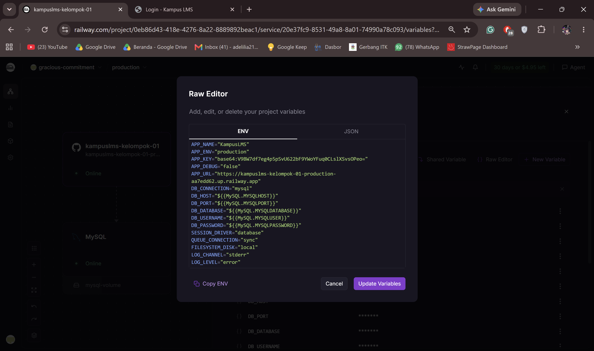
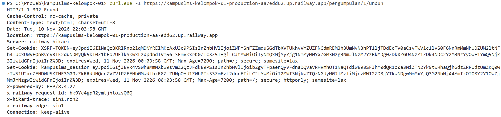
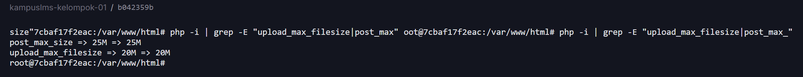

# Deployment KampusLMS — Kelompok 01

## 1. Spesifikasi server
 
| Komponen | Nilai |
|---|---|
| Platform | Railway (deploy berbasis Dockerfile) |
| Region / sumber daya | (isi dari Settings service di Railway) |
| Sistem operasi image | Debian (image resmi `php:8.4-apache`) |
| PHP | 8.4.27 |
| Laravel | 12.71.0 |
| Composer | 2.11.1 |
| Web server | Apache 2 dengan `mpm_prefork`, `mod_rewrite`, document root `/var/www/html/public` |
| Database | MySQL (service bawaan Railway, diakses lewat jaringan privat) |
| Build aset | Vite + Tailwind, dibuild di tahap 1 Dockerfile (`node:20-alpine`) |
| Proses latar belakang | Supervisor menjalankan Apache dan 2 proses `queue:work` |
| Session / Queue / Cache | `database` / `database` / `database` |
| Zona waktu aplikasi | Asia/Makassar |
| Batas unggah PHP | `upload_max_filesize=20M`, `post_max_size=25M` |

## 2. Langkah dari nol
 
### 2.0 Prasyarat
 
- Akun GitHub dan akun Railway (login memakai GitHub).
- Git dan Node.js terpasang di laptop (Node.js dipakai untuk Railway CLI).
- Kode KampusLMS sudah ada di repositori GitHub pada branch `main`.
### 2.1 Siapkan berkas deployment di repositori
 
Pastikan berkas berikut ada di repositori dan sudah di-*push* ke `main`:
 
| Berkas | Fungsi |
|---|---|
| `Dockerfile` | Tahap 1 membangun aset Vite. Tahap 2 memakai `php:8.4-apache`: memasang ekstensi `pdo_mysql`, `bcmath`, `zip`; mengatur `mpm_prefork`, `mod_rewrite`, `AllowOverride All`, document root ke `public/`; memasang Supervisor; menjalankan `composer install --no-dev`; menyalin `docker/start.sh` dan `docker/supervisord.conf`. |
| `docker/start.sh` | Skrip start container: mengatur port Apache dari variabel `PORT`, menjalankan `php artisan migrate --force`, membuat cache produksi (`config`, `route`, `view`, `event`), `storage:link`, memperbaiki kepemilikan `storage` dan `bootstrap/cache`, lalu menjalankan Supervisor. |
| `docker/supervisord.conf` | Mendefinisikan program `apache` dan `kampuslms-worker` (2 proses `queue:work`). Memuat bagian `unix_http_server`, `rpcinterface:supervisor`, dan `supervisorctl` agar `supervisorctl status` berfungsi. |
| `.dockerignore` | Mencegah `.env`, `vendor`, `node_modules`, dan berkas upload ikut masuk ke image. |
 
### 2.2 Buat project di Railway
 
1. Buka https://railway.app, login dengan GitHub.
2. Klik **New Project**.
 
### 2.3 Tambahkan database MySQL
 
1. Di project, klik **+ Create** → **Database** → **Add MySQL**
   (atau pilih **Provision MySQL** saat project baru dibuat).
2. Tunggu service MySQL berstatus hijau (**Online**).
3. Tidak perlu membuat tabel manual. Tabel dibuat oleh `php artisan migrate`
   yang dijalankan `docker/start.sh`.
 
### 2.4 Hubungkan repositori GitHub
 
1. Klik **+ Create** → **GitHub Repo**, pilih repositori KampusLMS.
2. Pastikan branch yang terhubung adalah `main`.
3. Aktifkan **Auto Deploy** bila belum aktif, supaya setiap `git push` ke `main`
   memicu deployment baru.
4. Bila repositori tidak muncul di daftar, klik **Configure GitHub App**, pilih
   *Only select repositories*, lalu pilih repositori KampusLMS.
Railway mendeteksi `Dockerfile` di root dan membangun image otomatis. Deployment
pertama akan gagal atau belum berfungsi sebelum variabel pada langkah 2.5 diisi.
 
### 2.5 Isi Environment Variables
 
Buka service aplikasi → tab **Variables** → **Raw Editor**, lalu isi:
 
```env
APP_NAME="KampusLMS"
APP_ENV="production"
APP_KEY="base64:V9BW7df7eg4p5pSvU622bF9YWoYFuq0CLslXSvsOPeo="
APP_DEBUG="false"
APP_URL="https://kampuslms-kelompok-01-production-aa7edd62.up.railway.app"
DB_CONNECTION="mysql"
DB_HOST="${{MySQL.MYSQLHOST}}"
DB_PORT="${{MySQL.MYSQLPORT}}"
DB_DATABASE="${{MySQL.MYSQLDATABASE}}"
DB_USERNAME="${{MySQL.MYSQLUSER}}"
DB_PASSWORD="${{MySQL.MYSQLPASSWORD}}"
SESSION_DRIVER="database"
QUEUE_CONNECTION="sync"
FILESYSTEM_DISK="local"
LOG_CHANNEL="stderr"
LOG_LEVEL="error"
```
 
### 2.6 Buat domain publik (HTTPS)
 
1. Buka service aplikasi → tab **Settings** → **Networking** → **Public Networking**.
2. Klik **Generate Domain**.
3. Bila diminta port, isi **`8080`** (port default yang dipakai `docker/start.sh`
   bila variabel `PORT` tidak ada).
4. Railway menerbitkan domain `*.up.railway.app` dengan sertifikat HTTPS otomatis.
Pengalihan HTTP ke HTTPS ditangani oleh Railway. Pengujiannya ada di bagian
 
### 2.7 Deploy pertama dan migrasi otomatis
 
1. Setelah variabel diisi, Railway membangun ulang image dan menjalankan container.
2. Buka tab **Deploy Logs**. Urutan yang diharapkan: migrasi berjalan tanpa galat,
   lalu Supervisor menyalakan `apache` dan `kampuslms-worker`.
3. Status deployment harus **Active**.
Bila status *Crashed*, baca bagian 4 (cara membaca log) dan bagian 8 (masalah yang
pernah ditemui).

### 2.8 Verifikasi Supervisor dan queue worker
 
```powershell
railway ssh
```
```bash
date
supervisorctl status
php artisan about
```


## 3. Cara deployment ulang
 
Ada tiga situasi: kode berubah, hanya variabel berubah, atau ingin kembali ke
versi sebelumnya. Setelah ketiganya, lakukan pemeriksaan di bagian 3.5.
 
### 3.1 Deploy ulang karena kode berubah (cara utama)
 
1. Pastikan perubahan sudah diuji di lokal, lalu commit dan push ke `main`:
```bash
   git add .
   git commit -m "pesan perubahan"
   git push origin main
```
2. Railway mendeteksi *push* (Auto Deploy) dan memulai deployment baru. Urutannya:
   1. **Build tahap 1:** `npm ci` dan `npm run build` membangun aset Vite.
   2. **Build tahap 2:** `composer install --no-dev`, salin kode dan aset.
   3. **Start container:** `docker/start.sh` menjalankan `php artisan migrate --force`,
      membuat ulang cache (`config`, `route`, `view`, `event`), lalu menyalakan
      Supervisor (Apache + 2 queue worker).
3. Pantau di tab **Deployments**: status berjalan dari *Building* → *Deploying* →
   **Active**. Bila *Failed* atau *Crashed*, buka **Build Logs** / **Deploy Logs**
   (lihat bagian 4).
Yang **tidak** terjadi pada deploy ulang:
 
- Seeder tidak dijalankan lagi, sehingga data dan kata sandi demo tidak berubah.
- Berkas unggahan tidak hilang karena tersimpan di Volume (`storage/app`).
- Queue worker tidak perlu di-restart manual: container baru otomatis menjalankan
  worker dengan kode terbaru. (Di VPS biasa, langkah ini memakai
  `php artisan queue:restart`.)
Bila *push* tidak memicu deployment (Auto Deploy tidak aktif):
 
- Buka service → **Settings** → pastikan repositori dan branch `main` benar.
- Klik **Disconnect** pada repositori, lalu **Connect Repo** ulang.
- Bila bekerja di branch lain, kirim ke `main` dengan `git push origin production:main`.
### 3.2 Deploy ulang tanpa perubahan kode
 
Dipakai setelah mengubah variabel atau saat container bermasalah:
 
1. Tekan `Ctrl+K`, ketik `redeploy`, tekan Enter; atau
2. Buka tab **Deployments** → ikon `...` pada deployment teratas → **Redeploy**.
Bila tombol aksi tidak terlihat, Anda sedang membuka tampilan rincian log. Klik
tanda `✕` untuk kembali ke daftar deployment.
 
### 3.3 Mengubah Environment Variables
 
1. Service aplikasi → tab **Variables** → ubah nilainya.
2. Terapkan perubahan dengan **Deploy** (atau Redeploy, 3.2). Variabel baru baru
   berlaku setelah container dibuat ulang.
3. Perubahan variabel sengaja harus lewat deployment baru, karena `docker/start.sh`
   membuat cache konfigurasi saat container start. Hasil cache lama tidak ikut
   berubah di container yang sedang berjalan.
4. Verifikasi dengan `php artisan about` di dalam container (`railway ssh`).
### 3.4 Kembali ke versi sebelumnya (rollback)
 
1. Tab **Deployments** → cari deployment terakhir yang berstatus berhasil.
2. Klik `...` → **Rollback** (atau **Redeploy** pada deployment lama tersebut,
   sesuai menu di dashboard Anda).
3. Lakukan pemeriksaan di 3.5.
Peringatan: rollback hanya mengembalikan **kode dan image**. Migrasi database
yang sudah dijalankan **tidak dibatalkan**. Bila deployment yang gagal membawa
migrasi baru, pertimbangkan apakah versi lama masih cocok dengan skema yang sudah
berubah. Bila perlu, perbaiki ke depan (commit perbaikan) daripada rollback.
 
### 3.5 Pemeriksaan setelah deployment
 
Jalankan dan catat hasilnya setelah setiap deploy penting:
 
```powershell
# dari laptop
curl.exe -I https://kampuslms-kelompok-01-production-aa7edd62.up.railway.app/
railway ssh
```
```bash
# di dalam container
supervisorctl status      # apache dan kedua kampuslms-worker harus RUNNING
php artisan about         # production, Debug OFF, Queue database, cache CACHED
exit
```
 
Lalu, di browser: login, buka halaman utama, dan coba satu alur inti (misalnya
dosen membuat tugas, mahasiswa menerima notifikasi). Setelah perubahan yang
menyentuh otorisasi, jalankan ulang `scripts/test-authz.sh` terhadap produksi
(bagian 6).

## 4. Cara membaca log
 
- **Dashboard Railway:** service aplikasi → tab **Build Logs** (proses build image)
  dan **Deploy Logs** (log container yang berjalan).
- **Laravel:** `LOG_CHANNEL=stderr`, jadi galat aplikasi muncul di Deploy Logs.
- **Apache dan queue worker:** keluaran diarahkan Supervisor ke stdout/stderr,
  sehingga ikut muncul di Deploy Logs.
- **Lewat CLI:** `railway logs` menampilkan log deployment terbaru.
- **Di dalam container:** `railway ssh`, lalu `supervisorctl status` untuk
  melihat status proses.
(Tambahkan contoh nyata satu baris log galat yang pernah Anda baca dan artinya.)
x

## 5. Daftar periksa keamanan produksi
Diuji pada: <tanggal 11 November 2026, jam 5:28> — domain: https://kampuslms-kelompok-01-production-aa7edd62.up.railway.app/

### 5.1 APP_DEBUG=false & APP_ENV=production
Perintah: `php artisan about`



### 5.2 /.env tidak bisa diakses
Perintah: `curl.exe -I https://DOMAIN/.env`


### 5.3 Log dan `composer.json` tidak dapat diakses
Perintah: `curl.exe -I https://DOMAIN/storage/logs/laravel.log`
          `curl.exe -I https://DOMAIN/composer.json`




### 5.4 HTTPS aktif dan HTTP dialihkan ke HTTPS
perintah: `curl.exe -I http://DOMAIN/ lalu curl.exe -I https://DOMAIN/`


### 5.5 Cookie sesi aman
Perintah: `curl.exe -i https://DOMAIN/`


### 5.6 Kredensial database dan kata sandi akun demo


### 5.7 Berkas submission membutuhkan login


### 5.8 Supervisor dan queue worker


### 5.9 Batas unggah PHP
Perintah (di dalam container): `php -i | grep -E "upload_max_filesize|post_max_size"`


## 6. Masalah yang ditemui dan cara mengatasinya
| Gejala | Cara menemukan penyebab | Penyebab | Solusi |
|---|---|---|---|
| Build di Railway gagal, `Dockerfile` kosong | `unzip -l` pada zip proyek menunjukkan `Dockerfile` berukuran 0 byte | File dibuat tetapi isinya belum ditulis | Mengisi `Dockerfile` multi-stage yang disesuaikan dengan proyek (Node untuk Vite, PHP 8.4 + Apache) |
| Semua halaman error 500 "Vite manifest not found" | Memeriksa `.gitignore` (`public/build` tidak ikut repo) dan `layout.blade.php` yang memakai `@vite` | Dockerfile di panduan tidak menjalankan `npm run build`, sehingga `public/build/manifest.json` tidak ada | Menambah stage `node:20-alpine` yang menjalankan `npm run build`, lalu `COPY --from=assets /app/public/build ./public/build` |
| CSS/JS tidak termuat (mixed content, URL aset `http://`) | Membaca `bootstrap/app.php`: tidak ada `trustProxies`, padahal Railway menerima HTTPS di depan aplikasi | Laravel tidak mengenali request asli HTTPS dari proxy Railway | Menambah `$middleware->trustProxies(at: '*');` di `bootstrap/app.php` |
| Aplikasi crash saat start, provider/package dev tidak ditemukan | Memeriksa isi zip: `bootstrap/cache/*.php`, `.env` lokal, dan `public/hot` ikut tersalin oleh `COPY . .` | Cache package hasil `composer install` dev (debugbar, dll.) terbawa, sedangkan image memakai `--no-dev`; `.env` lokal (`DB_HOST=127.0.0.1`) dan `hot` ikut masuk | Membuat `.dockerignore` yang mengecualikan `.env`, `public/hot`, `bootstrap/cache/*.php`, `vendor`, `node_modules`, dan isi `storage` |
| Notifikasi tugas baru dan nilai tidak muncul | Melihat `QUEUE_CONNECTION=database` dan listener/notifikasi yang `ShouldQueue`; Dockerfile hanya menjalankan Apache | Tidak ada proses `queue:work`, sehingga job menumpuk di tabel `jobs` | Menjalankan queue worker (Supervisor atau service Railway terpisah) |
| Data demo (user dan tugas) bertambah setiap redeploy | Membaca `DatabaseSeeder`: memakai factory acak, sedangkan `CMD` menjalankan `db:seed` di setiap start | Seeder dijalankan ulang pada setiap container start | Seeder cukup dijalankan sekali; setelah deploy pertama, hapus `db:seed` dari `CMD` |
| Migrasi gagal tetapi deploy tampak sukses, tabel tidak ada | Membaca `CMD` di panduan: `(php artisan migrate --force \|\| true)` | `\|\| true` menelan error migrasi sehingga container tetap berjalan | Cek Deploy Logs setelah deploy; hapus `\|\| true` agar kegagalan migrasi langsung terlihat |
| File materi dan tugas yang diunggah hilang setelah redeploy | Memeriksa kode upload: file disimpan di disk `local` (`storage/app/private`) | Filesystem container Railway bersifat sementara | Menambah Volume Railway dengan mount path `/var/www/html/storage/app/private` |
| Login akun demo gagal | Membaca `DatabaseSeeder` dan `config/demo.php`: login memakai NIM/NIP dan kata sandi dari `DEMO_PASSWORD` | Panduan memakai email (`admin@kampus.id`) yang tidak ada di seeder | Login dengan NIM/NIP dari seeder (mis. NIP `198001012005011001` untuk admin) dan `DEMO_PASSWORD` yang diatur di Variables |
| `APP_KEY` di panduan tersebar di dokumen | Membaca contoh Variables di `PANDUAN_DEPLOY_RAILWAY.md` | Key contoh dipakai bersama banyak orang sehingga tidak aman | Membuat key sendiri dengan `php artisan key:generate --show` dan mengisinya di Variables |