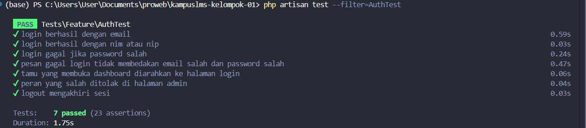
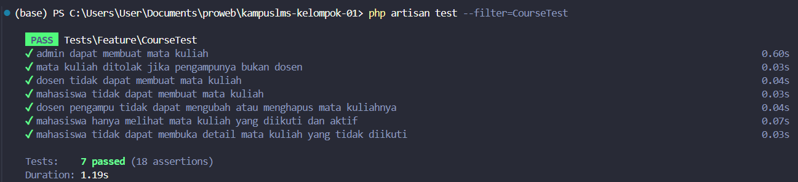
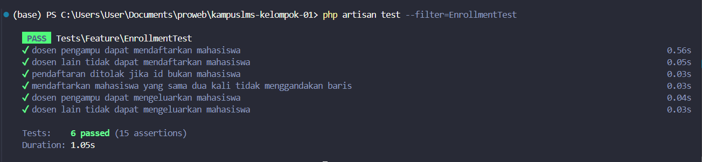
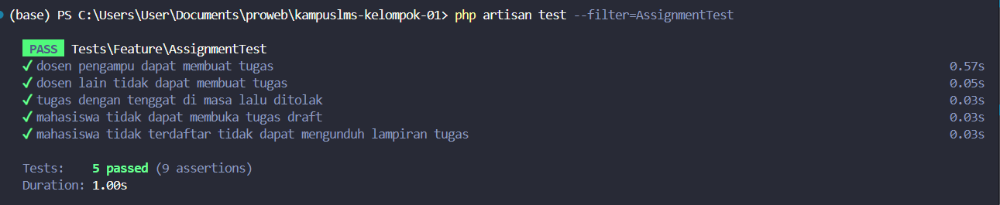
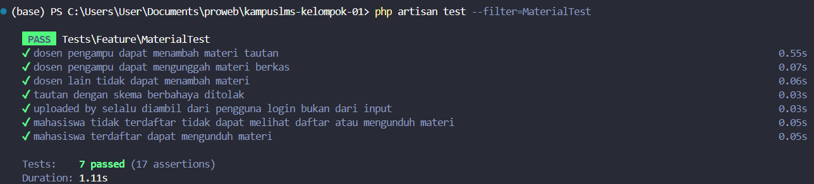
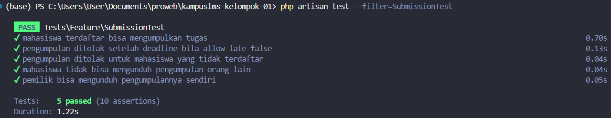
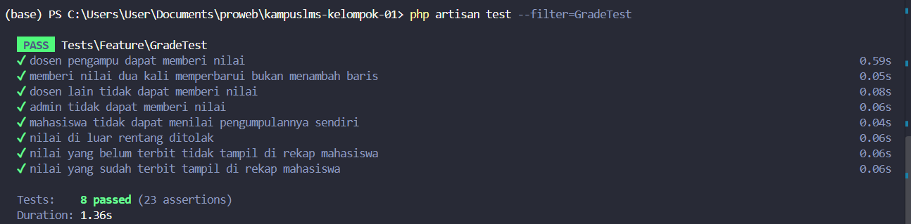
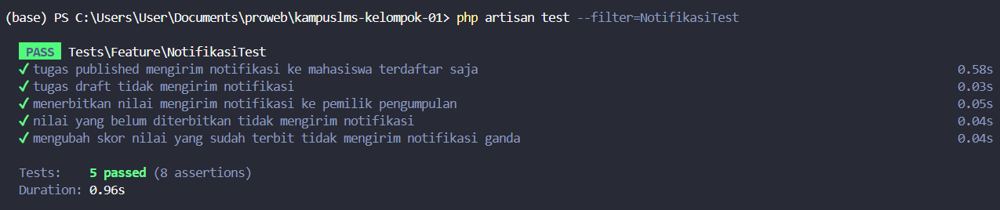

## Daftar Titik Rawan IDOR (Sebelum)

Tabel ini disusun dari hasil `route:list` dan pembacaan `CourseController` serta `UserController`. Semua route berparameter model saat ini hanya memiliki middleware `web` (session, cookie, CSRF). Parameter `{mata_kuliah}` dan `{user}` sudah memakai route model binding, tetapi binding hanya menjamin data itu ada, bukan bahwa pengguna berhak mengaksesnya.

| No | Route | Model | Aksi | Siapa seharusnya boleh | Yang mencegah saat ini | Risiko | Rencana penutup | 
|----|-----------------------|-------|------|------------------------|------------------------|--------|-----------------|
| 1 | `admin/mata-kuliah/{mata_kuliah}` (1-4) | Course | show, edit, update, destroy | Admin | Belum ada | Siapa pun dapat melihat, mengubah, atau menghapus mata kuliah mana pun dengan mengganti ID di URL | Middleware `role:admin` (Minggu 5), lalu `CoursePolicy` dengan `Gate::authorize()` (Minggu 7) |
| 2 | `dosen/mata-kuliah/{mata_kuliah}` (5-7) | Course | show, edit, update | Dosen pengampu mata kuliah itu | Belum ada | Dosen A dapat mengedit mata kuliah dosen B. Middleware `role:dosen` saja tidak cukup karena meloloskan semua dosen | Middleware `role:dosen` (Minggu 5), pemeriksaan `lecturer_id` sementara dengan `abort_unless` (Minggu 5), lalu `CoursePolicy@update` (Minggu 7) |
| 3 | `mahasiswa/mata-kuliah/{mata_kuliah}` (8) | Course | show | Mahasiswa yang terdaftar di mata kuliah itu, dosen pengampu, dan admin | Belum ada | Mahasiswa dapat membuka mata kuliah yang tidak diikutinya | Middleware `role:mahasiswa` (Minggu 5), lalu `CoursePolicy@view` yang memeriksa keanggotaan (Minggu 7) |
| 4 | `mata-kuliah/{mata_kuliah}` tanpa prefix (9-12) | Course | show, edit, update, destroy | Sama seperti route berprefix per aksi. Route ini sendiri tidak punya peran (duplikat dari `admin/mata-kuliah`) | Belum ada | Menjadi jalan pintas yang melewati penjagaan grup berprefix, karena URL-nya tidak diawali nama peran | Dihapus atau dijaga saat penyusunan ulang `routes/web.php` (BUILD Minggu 5) |
| 5 | `admin/users/{user}` (13-16) | User | show, edit, update, destroy | Admin | Belum ada | Siapa pun dapat melihat data pengguna lain (nama, email, role), mengubah, atau menghapusnya | Middleware `role:admin` (Minggu 5), lalu `UserPolicy` (Minggu 7) |
| 6 | `users/{user}` tanpa prefix (17-20) | User | show, edit, update, destroy | Sama seperti `admin/users/{user}`. Route ini sendiri tidak punya peran (duplikat dari `admin/users`) | Belum ada | Sama seperti baris 5, dan menjadi jalan pintas yang melewati penjagaan grup `admin/` | Dihapus atau dijaga saat penyusunan ulang `routes/web.php` (BUILD Minggu 5) |

### Catatan tambahan: kebocoran tingkat daftar (route `index`)

Route `index` tidak menerima parameter model, sehingga bukan IDOR pada satu objek. Namun keduanya mengambil seluruh data tanpa menyaring berdasarkan peran, dan akan ditutup di Minggu 7 dengan penyaringan di level query.

| Route | Kondisi saat ini | Yang seharusnya |
|-------|------------------|-----------------|
| `mata-kuliah`, `admin/mata-kuliah`, `dosen/mata-kuliah`, `mahasiswa/mata-kuliah` | Menampilkan semua mata kuliah untuk siapa pun | Admin: semua. Dosen: yang diampunya. Mahasiswa: yang diikutinya |
| `users`, `admin/users` | Menampilkan semua pengguna beserta email | Admin saja |

# Daftar Titik Rawan IDOR

Tabel berikut memuat titik rawan IDOR yang telah diperiksa berdasarkan
implementasi terbaru. Kolom pengaman menunjukkan Policy, middleware,
query, atau perubahan route yang benar-benar digunakan saat ini.

Daftar IDOR pada bagian ini juga telah diperbarui dengan menambahkan beberapa route yang sebelumnya belum tercantum, terutama route terkait materi, tugas, pengumpulan tugas (*submission*), penilaian (*grade*), dan endpoint API. Penambahan dilakukan berdasarkan pemeriksaan terbaru terhadap `routes/web.php`, `routes/api.php`, controller, middleware, dan Policy yang digunakan setelah sampai di minggu 7. Tujuannya agar pendataan titik rawan IDOR lebih lengkap.

| No | Route | Model | Aksi | Siapa seharusnya boleh | Yang mencegah saat ini | Risiko / Status | Hasil dari Rencana penutup |
|----|-----------------------|-------|------|------------------------|------------------------|-----------------|-----------------|
| 1 | `admin/mata-kuliah/{mata_kuliah}` (1-4) | Course | show, edit, update, destroy | Admin | Middleware `auth` dan `role:admin`, serta `CoursePolicy` melalui `Gate::authorize()` pada aksi show, edit, update, dan destroy. | Akses dibatasi untuk admin. | Sudah diterapkan. |
| 2 | `dosen/mata-kuliah/{mata_kuliah}` (5-7) | Course | show | Dosen pengampu mata kuliah tersebut | Middleware `auth` dan `role:dosen`, `CoursePolicy::view()`, Akses `index` difilter berdasarkan peran pengguna, sedangkan akses `show` diperiksa melalui `CoursePolicy::view`. Route ini hanya menyediakan halaman daftar dan detail mata kuliah, tidak mencakup aksi edit atau update. | Dosen tidak dapat mengedit atau mengubah mata kuliah milik dosen lain melalui route ini. | Sudah dibatasi sesuai route dan Policy saat ini. |
| 3 | `mahasiswa/mata-kuliah/{mata_kuliah}` (8) | Course | show | Mahasiswa yang terdaftar pada mata kuliah tersebut | Middleware `auth` dan `role:mahasiswa`, serta `CoursePolicy::view()` yang memeriksa `isManagedBy()` atau `hasStudent()`. | Mahasiswa yang tidak terdaftar tidak dapat membuka detail mata kuliah melalui aksi show. | Sudah diterapkan. |
| 4 | `mata-kuliah/{mata_kuliah}` tanpa prefix (9-12) | Course | show, edit, update, destroy | Sesuai hak akses masing-masing peran | Route tanpa prefix tersebut sudah dihapus. | Jalur duplikat tanpa prefix sudah tidak ditemukan. | Sudah diterapkan untuk dihapus; dan di pastikan route tersebut tidak ditambahkan kembali. |
| 5 | `admin/users/{user}` (13-16) | User | show, edit, update, destroy | Admin | Middleware `auth` dan `role:admin` pada grup route. | Non-admin telah dibatasi oleh middleware, Seluruh admin memiliki hak akses yang sama. | Middleware sudah diterapkan, namun penggunaan `UserPolicy` untuk pemeriksaan izin per objek belum diperlukan sesuai aturan akses saat ini. |
| 6 | `users/{user}` tanpa prefix (17-20) | User | show, edit, update, destroy | Admin | Route tanpa prefix tersebut sudah dihapus. | Jalur duplikat tanpa prefix sudah tidak ditemukan. | Sudah diterapkan untuk dihapus; dan di pastikan route tersebut tidak ditambahkan kembali. |
| 7 | `dosen/mata-kuliah/{course}/materi` | Course | index, create, store | Dosen pengampu mata kuliah | Middleware `auth` dan `role:dosen`. Aksi index memeriksa `CoursePolicy::view()`, sedangkan create/store memeriksa izin melalui `MaterialPolicy::create()`. Route nested menggunakan `scopeBindings()`. | Dosen yang tidak berhak tidak dapat mengakses atau menambahkan materi melalui mata kuliah tersebut jika pemeriksaan Policy menolaknya. | Sudah ada pemeriksaan Policy pada controller/request terkait. |
| 8 | `dosen/materi/{material}` | Material | show, edit, update, destroy | Dosen pengampu sesuai aturan Policy; route ini hanya untuk dosen | Middleware `auth` dan `role:dosen`, serta `MaterialPolicy::view()`, `update()`, dan `delete()` melalui `Gate::authorize()` atau Form Request. | Dosen yang bukan pengampu tidak dapat melihat, mengubah, atau menghapus materi milik mata kuliah lain jika Policy menolaknya. | Sudah diterapkan melalui Policy pada aksi terkait. |
| 9 | `mahasiswa/mata-kuliah/{course}/materi` | Course | index | Mahasiswa yang terdaftar pada mata kuliah | Middleware `auth` dan `role:mahasiswa`, serta `CoursePolicy::view()`. Route nested menggunakan `scopeBindings()`. | Mahasiswa yang tidak terdaftar tidak dapat mengakses daftar materi melalui mata kuliah tersebut jika Policy menolaknya. | Sudah diterapkan melalui pemeriksaan akses mata kuliah. |
| 10 | `mahasiswa/materi/{material}` | Material | show | Mahasiswa yang terdaftar pada mata kuliah terkait | Middleware `auth` dan `role:mahasiswa`, serta `MaterialPolicy::view()` yang memeriksa akses melalui relasi mata kuliah. | Mahasiswa yang tidak terdaftar tidak dapat melihat materi melalui route ini jika Policy menolaknya. | Sudah diterapkan melalui Policy. |
| 11 | `dosen/mata-kuliah/{course}/tugas` | Course | index, create, store | Dosen pengampu mata kuliah | Middleware `auth` dan `role:dosen`. Aksi index memeriksa `CoursePolicy::view()`, sedangkan create/store memeriksa `AssignmentPolicy::create()`. Route nested menggunakan `scopeBindings()`. | Dosen yang tidak berhak tidak dapat mengakses atau membuat tugas pada mata kuliah tersebut jika pemeriksaan Policy menolaknya. | Sudah diterapkan melalui pemeriksaan Policy pada controller. |
| 12 | `dosen/tugas/{assignment}` | Assignment | show, edit, update, destroy | Dosen pengampu mata kuliah terkait | Middleware `auth` dan `role:dosen`, serta `AssignmentPolicy::view()`, `update()`, dan `delete()` melalui `Gate::authorize()`. | Dosen yang bukan pengampu tidak dapat melihat, mengubah, atau menghapus tugas milik dosen lain jika Policy menolaknya. | Sudah diterapkan melalui Policy. |
| 13 | `mahasiswa/mata-kuliah/{course}/tugas` | Course | index | Mahasiswa yang terdaftar pada mata kuliah | Middleware `auth` dan `role:mahasiswa`, serta `CoursePolicy::view()`. Daftar tugas untuk mahasiswa difilter agar hanya menampilkan tugas berstatus `published`. | Mahasiswa yang tidak terdaftar tidak dapat mengakses daftar tugas melalui mata kuliah tersebut jika Policy menolaknya. | Sudah diterapkan melalui pemeriksaan akses mata kuliah dan filter status tugas. |
| 14 | `mahasiswa/tugas/{assignment}` | Assignment | show | Mahasiswa yang terdaftar pada mata kuliah dan tugas berstatus `published` | Middleware `auth` dan `role:mahasiswa`, serta `AssignmentPolicy::view()` yang memeriksa status tugas dan pendaftaran mahasiswa. | Mahasiswa yang tidak terdaftar atau tugas yang belum dipublikasikan tidak dapat dilihat jika Policy menolaknya. | Sudah diterapkan melalui Policy. |
| 15 | `api/v1/courses/{course}` | Course | show | Admin, dosen pengampu, atau mahasiswa yang terdaftar sesuai Policy | Middleware `auth:sanctum` dan `Gate::authorize('view', $course)` yang memanggil `CoursePolicy::view()`. | Pengguna yang tidak berhak tidak dapat membuka detail mata kuliah melalui API jika Policy menolaknya. | Sudah diterapkan melalui Policy. |
| 16 | `api/v1/courses/{course}/assignments` | Course | index | Pengguna yang berhak melihat mata kuliah terkait | Middleware `auth:sanctum`, `CoursePolicy::view()`, dan query relasi tugas dengan scope `visibleTo()`. | Pengguna yang tidak berhak tidak dapat mengakses daftar tugas mata kuliah; data tugas disaring melalui query. | Sudah diterapkan melalui Policy dan query. |
| 17 | `api/v1/courses/{course}/materials` | Course | index | Admin, dosen pengampu, atau mahasiswa terdaftar sesuai Policy | Middleware `auth:sanctum`, `CoursePolicy::view()`, serta query materi yang difilter berdasarkan role dan relasi pengguna. | Pengguna yang tidak berhak tidak dapat mengakses daftar materi melalui mata kuliah terkait jika Policy menolaknya. | Sudah diterapkan melalui Policy dan query. |
| 18 | `api/v1/assignments/{assignment}` | Assignment | update, destroy | Dosen pengampu mata kuliah terkait | Middleware `auth:sanctum`, serta `AssignmentPolicy::update()` dan `delete()` melalui `Gate::authorize()`. | Pengguna yang bukan dosen pengampu tidak dapat mengubah atau menghapus tugas jika Policy menolaknya. | Sudah diterapkan melalui Policy. |
| 19 | `api/v1/assignments/{assignment}/submissions` | Assignment | index, store | Index: pihak yang berhak melihat submission. Store: mahasiswa terdaftar yang boleh mengumpulkan tugas | Middleware `auth:sanctum`. Aksi index memeriksa `AssignmentPolicy::view()` dan membatasi query submission milik mahasiswa. Aksi store memeriksa `AssignmentPolicy::submit()` melalui `StoreSubmissionRequest`. | Mahasiswa tidak dapat melihat submission mahasiswa lain melalui query index; pengumpulan dibatasi berdasarkan status tugas dan pendaftaran. | Sudah diterapkan melalui Policy dan pembatasan query. |
| 20 | `api/v1/submissions/{submission}/grade` | Submission (terkait Grade) | update | Dosen pengampu mata kuliah dari tugas terkait | Middleware `auth:sanctum`; `GradeSubmissionRequest` memeriksa izin `GradePolicy::create()` atau `GradePolicy::update()` berdasarkan submission dan grade terkait. | Pengguna yang bukan dosen pengampu tidak dapat memberi atau mengubah nilai jika pemeriksaan Policy menolaknya. | Sudah diterapkan melalui Form Request dan Policy. |
| 21 | `api/v1/notifications/{id}/read` | Notification | read | Pengguna yang memiliki notifikasi terkait | Middleware autentikasi dan pemeriksaan kepemilikan notifikasi pada proses penandaan telah dibaca. | Pengguna tidak boleh menandai notifikasi milik pengguna lain sebagai telah dibaca. | Pembatasan kepemilikan sudah diterapkan pada controller. Pengujian langsung masih diperlukan untuk memvalidasi perilakunya. |
| 22 | `admin/mata-kuliah/{course}/materi` | Course | index | Admin | Middleware `auth` dan `role:admin`. `MaterialController::index()` menjalankan `Gate::authorize('view', $course)` yang memeriksa `CoursePolicy::view()`. Route juga menggunakan `scopeBindings()`. | Akses daftar materi dibatasi oleh middleware dan pemeriksaan Policy terhadap course. | Middleware dan Policy sudah diterapkan untuk membatasi akses berdasarkan autentikasi, role, dan hak akses terhadap course. |
| 23 | `admin/mata-kuliah/{course}/tugas` | Course | index | Admin | Middleware `auth` dan `role:admin`. `AssignmentController::index()` menjalankan `Gate::authorize('view', $course)` melalui `CoursePolicy::view()`. Route menggunakan `scopeBindings()`. | Akses daftar tugas dibatasi oleh middleware dan pemeriksaan Policy terhadap course. | Middleware dan Policy sudah diterapkan untuk memastikan akses sesuai hak pengguna terhadap course. |
| 24 | `admin/mata-kuliah/{mata_kuliah}/mahasiswa` | Course | store | Admin | Middleware `auth` dan `role:admin`. `CourseEnrollmentController::store()` memanggil `Gate::authorize('manageEnrollment', $mata_kuliah)` melalui `CoursePolicy`. ID mahasiswa juga divalidasi agar mengacu pada pengguna yang terdaftar dan memiliki role mahasiswa. | Pengguna non-admin dibatasi oleh middleware. ID mahasiswa yang tidak memenuhi ketentuan validasi seharusnya ditolak. | Middleware, Policy, dan validasi ID mahasiswa sudah diterapkan untuk membatasi pengelolaan peserta mata kuliah. |
| 25 | `admin/mata-kuliah/{mata_kuliah}/mahasiswa/{student}` | Course dan ID mahasiswa (User) | destroy | Admin | Middleware `auth` dan `role:admin`. `CourseEnrollmentController::destroy()` memanggil `Gate::authorize('manageEnrollment', $mata_kuliah)`. Parameter `{student}` diterima sebagai integer, kemudian digunakan untuk menghapus relasi mahasiswa dengan course. | Pengguna non-admin dibatasi oleh middleware dan Policy course. Pengujian penggantian ID mahasiswa diperlukan untuk memastikan hanya relasi yang dituju yang terpengaruh. | Middleware dan Policy course sudah diterapkan. Pengujian dengan ID mahasiswa berbeda tetap disarankan.|    
| 26 | `admin/materi/{material}` | Material | show, edit, update, destroy | Admin | Middleware autentikasi dan role pada rute admin, serta Gate::authorize() pada aksi show, edit, update, dan destroy. MaterialPolicy memeriksa hak akses berdasarkan mata kuliah terkait. | Pemeriksaan akses pada keempat aksi sudah diterapkan. Risiko akses tanpa izin melalui manipulasi ID dibatasi oleh Policy, selama middleware dan konfigurasi Policy berjalan sesuai rute yang aktif. | Setiap aksi materi telah memiliki pemeriksaan otorisasi pada controller. |
| 27 | `admin/tugas/{assignment}` | Assignment | show, edit, update, destroy | Admin | Middleware autentikasi dan role pada rute admin, serta Gate::authorize() pada aksi show, edit, update, dan destroy. AssignmentPolicy memeriksa hak akses berdasarkan mata kuliah dan status tugas bagi mahasiswa. | Pemeriksaan akses pada keempat aksi sudah diterapkan. Risiko akses tanpa izin melalui manipulasi ID dibatasi oleh Policy, selama middleware dan konfigurasi Policy berjalan sesuai rute yang aktif. | Setiap aksi tugas telah memiliki pemeriksaan otorisasi pada controller. |
| 28 | `mahasiswa/tugas/{assignment}/kumpul` | Assignment | store | Mahasiswa yang terdaftar pada mata kuliah dan memenuhi ketentuan pengumpulan tugas | Middleware `auth` dan `role:mahasiswa`. `SubmissionController::store()` memanggil `Gate::authorize('submit', $assignment)`. Policy memeriksa status tugas, status course, dan keikutsertaan mahasiswa. ID pemilik pengumpulan ditetapkan dari pengguna yang sedang login, serta pengumpulan duplikat dicegah. | Mahasiswa yang tidak memenuhi ketentuan pengumpulan seharusnya ditolak. Kepemilikan submission ditetapkan berdasarkan pengguna yang login, bukan ID pemilik dari input pengguna. | Middleware, Policy, dan penetapan pemilik pengumpulan sudah diterapkan untuk membatasi pengumpulan tugas. |
| 29 | `pengumpulan/{submission}/unduh` | Submission | download | Mahasiswa pemilik pengumpulan, dosen pengelola course, atau admin sesuai policy | Middleware `auth`. `SubmissionController::download()` memanggil `Gate::authorize('view', $submission)` melalui `SubmissionPolicy`. Mahasiswa hanya dapat mengakses pengumpulannya sendiri, sedangkan dosen dan admin harus memenuhi ketentuan akses course. File diambil dari disk `local`. | Penggantian ID submission milik pengguna lain seharusnya ditolak jika pemeriksaan Policy berjalan sesuai ketentuan. Pengujian lintas akun tetap diperlukan. | Policy sudah diterapkan untuk membatasi akses unduhan berdasarkan kepemilikan pengumpulan dan hak akses terhadap course. |
| 30 | `dosen/mata-kuliah/{mata_kuliah}/mahasiswa` | Course dan User (mahasiswa) | store | Dosen pengampu mata kuliah tersebut | Middleware `auth` dan `role:dosen`. `CourseEnrollmentController::store()` memanggil `Gate::authorize('manageEnrollment', $mata_kuliah)` melalui `CoursePolicy`. Daftar ID mahasiswa divalidasi agar hanya berisi ID pengguna dengan role `mahasiswa` yang belum dihapus. | Dosen yang bukan pengampu seharusnya ditolak. ID pengguna yang tidak memenuhi validasi juga ditolak. | Pemeriksaan kepemilikan mata kuliah dan validasi mahasiswa sudah diterapkan. |
| 31 | `dosen/mata-kuliah/{mata_kuliah}/mahasiswa/{student}` | Course dan User (mahasiswa) | destroy | Dosen pengampu mata kuliah tersebut | Middleware `auth` dan `role:dosen`. `CourseEnrollmentController::destroy()` memeriksa `Gate::authorize('manageEnrollment', $mata_kuliah)` sebelum menghapus relasi melalui `detach($student)`. Parameter `student` dibatasi sebagai angka menggunakan `whereNumber()`. | Dosen yang bukan pengampu tidak dapat menghapus peserta dari mata kuliah dosen lain jika Policy berjalan sebagaimana mestinya. ID mahasiswa yang salah dapat membuat penghapusan tidak mengenai peserta yang dimaksud, tetapi tidak memberikan akses ke mata kuliah lain. | Policy dan pembatasan format parameter sudah diterapkan. |
| 32 | `dosen/pengumpulan/{submission}/nilai` | Submission dan Grade | update | Dosen pengampu mata kuliah dari tugas terkait | Middleware `auth` dan `role:dosen`. `GradeController::update()` menggunakan `StoreGradeRequest`, yang memeriksa `$this->user()->can('grade', $this->route('submission'))`. `SubmissionPolicy::grade()` meneruskan pemeriksaan ke `GradePolicy`, yang membatasi pemberian atau perubahan nilai kepada dosen pengampu. | Dosen lain tidak seharusnya dapat memberi atau mengubah nilai pengumpulan yang bukan kewenangannya. | Pemeriksaan otorisasi pada Form Request dan Policy sudah diterapkan. |
| 33 | `materi/{material}/unduh` | Material | download | Admin, dosen pengampu, atau mahasiswa terdaftar pada mata kuliah aktif | Middleware `auth`. `MaterialController::download()` memanggil `Gate::authorize('view', $material)`. `MaterialPolicy::view()` memeriksa pengelola mata kuliah atau keanggotaan mahasiswa pada mata kuliah berstatus `active`. File disimpan di disk privat dan keberadaan file diperiksa sebelum diunduh. | Pengguna yang menebak ID materi milik pihak lain seharusnya ditolak. Pengguna yang berhak tetap mendapat `404` jika materi bukan berkas atau file tidak ditemukan. | Pemeriksaan akses dan penyimpanan privat sudah diterapkan. |
| 34 | `tugas/{assignment}/lampiran` | Assignment | download | Admin, dosen pengampu, atau mahasiswa terdaftar pada mata kuliah aktif dengan tugas berstatus `published` | Middleware `auth`. `AssignmentController::download()` memanggil `Gate::authorize('view', $assignment)`. `AssignmentPolicy::view()` membatasi mahasiswa berdasarkan status tugas, status mata kuliah, dan pendaftaran; untuk admin atau dosen, akses bergantung pada `isManagedBy()`. File berada di disk privat dan keberadaannya diperiksa sebelum diunduh. | Mahasiswa yang tidak terdaftar atau mencoba mengunduh lampiran tugas draft seharusnya ditolak. File yang tidak tersedia menghasilkan `404`. | Pemeriksaan Policy dan penyimpanan privat sudah diterapkan. |

## Catatan Penyaringan Data pada Endpoint Index

| Route | Pengaman saat ini | Status |
|-------|-------------------|--------|
| `admin/mata-kuliah`, `dosen/mata-kuliah`, `mahasiswa/mata-kuliah` | `CourseController::index()` menggunakan `Course::query()->visibleTo($request->user())`. Scope `visibleTo()` membatasi data berdasarkan role di level query database. | Sudah diterapkan. Data mata kuliah yang ditampilkan sudah disesuaikan dengan hak akses masing-masing role. |
| `admin/users` | Middleware `auth` dan `role:admin` membatasi akses halaman daftar pengguna. `UserController::index()` menggunakan query `User::query()` dengan filter pencarian dan role opsional. | Sudah diterapkan. Hanya admin yang dapat membuka halaman daftar pengguna, dan seluruh admin dapat melihat semua akun sesuai kebutuhan sistem, dengan pilihan filter berdasarkan pencarian atau role. |

## Dokumentasi Bukti Pengujian

Tabel berikut berisi daftar pengujian keamanan yang telah dijalankan pada aplikasi KampusLMS beserta lokasi file pengujian dan bukti screenshot hasil pengujian.

| No. | Aspek Pengujian | Nama File Test | Bukti Screenshot |
|-----|-----------------|----------------|------------------|
| 1 | Autentikasi dan login | `tests/Feature/AuthTest.php` |  |
| 2 | Pengelolaan mata kuliah | `tests/Feature/CourseTest.php` |  |
| 3 | Pendaftaran mahasiswa | `tests/Feature/EnrollmentTest.php` |  |
| 4 | Pengelolaan tugas | `tests/Feature/AssignmentTest.php` |  |
| 5 | Pengelolaan materi | `tests/Feature/MaterialTest.php` |  |
| 6 | Pengumpulan tugas | `tests/Feature/SubmissionTest.php` |  |
| 7 | Pengelolaan nilai | `tests/Feature/GradeTest.php` |  |
| 8 | Notifikasi | `tests/Feature/NotifikasiTest.php` |  |

### Hasil Pengujian

Pengujian dilakukan menggunakan perintah `php artisan test` dengan hasil:

- Total pengujian: 51 test.
- Berhasil: 51 test.
- Gagal: 0 test.
- Assertions: 124.
- Status: Semua pengujian berhasil dijalankan.
