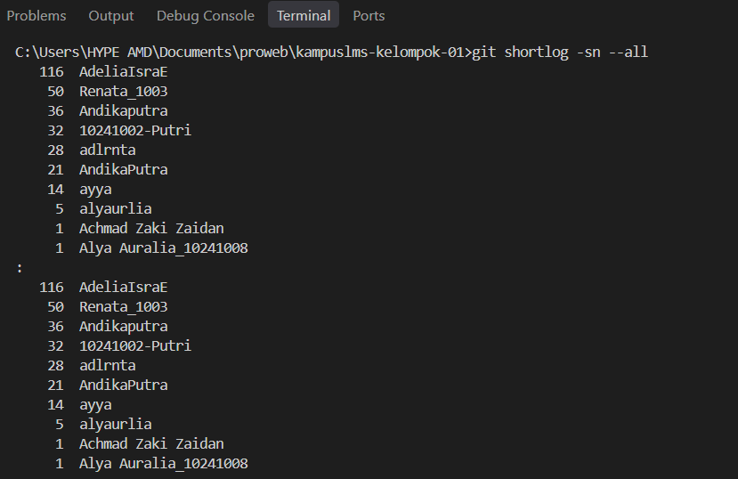
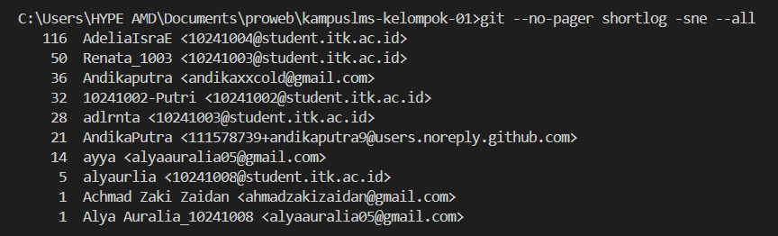
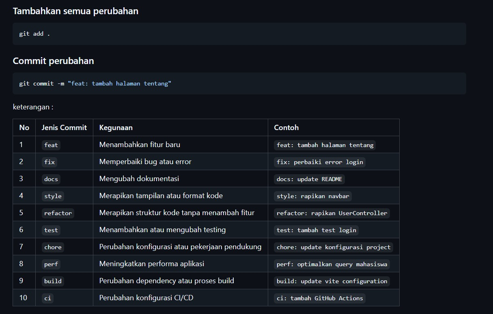

# READ — Baca riwayat kelompok Anda

Nama: Adelia Cyntia Renata

NIM: 10241003

### 1. Berapa commit atas nama Anda? Bandingkan dengan anggota lain.

Berikut adalah hasil pengecekan riwayat kontribusi menggunakan perintah `git shortlog`:

Total commit atas nama aku adalah 78 commit dari keseluruhan 304 commit di repositori ini, atau sekitar 25,66%. Angka itu terbagi ke dalam dua nama penulis yang berbeda, yaitu `Renata_1003` sebanyak 50 commit dan `adlrnta` sebanyak 28 commit. Dengan jumlah tersebut, aku berada di urutan kedua terbanyak di kelompok. Kedua akun itu sebenarnya memakai alamat email yang sama (`10241003@student.itk.ac.id`), tetapi tercatat terpisah karena ada perbedaan pengaturan `user.name` pada Git lokal di perangkat yang aku gunakan atau sempat berubah saat konfigurasi ulang.

Jika dibandingkan dengan anggota kelompok lain, jumlah commit terbanyak dipegang oleh `AdeliaIsraE` dengan total 116 commit (38,16%), sehingga selisihnya denganku adalah 38 commit. Di bawahku ada Andika dengan total 57 commit, Putri dengan 32 commit, Alya dengan 20 commit, serta Achmad Zaki Zaidan dengan 1 commit. Perlu dicatat bahwa beberapa anggota juga tercatat dengan lebih dari satu nama di riwayat Git—seperti Andika yang terpecah menjadi `Andikaputra` (36) dan `AndikaPutra` (21), serta Alya yang tercatat di tiga nama berbeda (`ayya`, `alyaurlia`, dan `Alya Auralia_10241008`)—sehingga angka mentahnya harus digabung terlebih dahulu agar perbandingannya akurat.

Menurutku, angka 78 commit ini sudah cukup menggambarkan kontribusiku secara teknis di bagian penulisan kode, meskipun belum sepenuhnya mencerminkan keseluruhan proses kerja kelompok. Masih banyak pekerjaan lain yang tidak tercatat di log commit, seperti diskusi pembagian tugas, perancangan alur fitur, pengujian manual aplikasi, hingga membantu anggota lain saat mengalami kendala *merge* atau *debugging*. Ke depannya, satu hal yang pasti akan aku ubah adalah memastikan konfigurasi `git config user.name` dan `git config user.email` diatur secara konsisten sejak awal proyek agar seluruh riwayat kontribusiku tercatat rapi dalam satu identitas saja.

### 2. Adakah minggu di mana Anda tidak punya commit sama sekali?

Aku menghitung commit per minggu dengan perintah berikut, difilter pakai email karena akunku tercatat dengan dua nama:

    $ git --no-pager log --all --reverse --format='%ad' --date=short | head -1
    2026-08-26

    $ git --no-pager log --all --author="10241003" --format='%ad' --date=format:'%Y-W%W' | sort | uniq -c
          1 2026-W35
         12 2026-W36
          6 2026-W37
          2 2026-W39
         23 2026-W40
         10 2026-W42
          6 2026-W43
          2 2026-W44
         16 2026-W45

Ya, ada dua minggu di mana aku tidak memiliki commit sama sekali, yaitu pada **W38** dan **W41**. Untuk **W34** dan **W46**, keduanya tidak aku hitung sebagai minggu kosong karena W34 adalah minggu inisialisasi awal repositori proyek (baru dimulai pada 26 Agustus 2026), sedangkan W46 adalah minggu berjalan saat tugas pengecekan riwayat ini dikerjakan.

Rentang yang kupakai: **2026-W34 s.d. 2026-W46**, dihitung dari tanggal commit pertama proyek yaitu **26 Agustus 2026** (`2026-08-26`).

Penyebab:
- **W38:** Pada minggu ini bagian tampilan antarmuka (*frontend*) dasar yang menjadi tanggung jawabku sudah selesai dibuat, sehingga aku sedang menunggu penyelesaian bagian *backend* (seperti struktur database dan penyediaan data/API) sebelum bisa melakukan integrasi fitur lebih lanjut.
- **W41:** Penyebabnya serupa dengan W38, di mana setelah lonjakan pengerjaan fitur pada minggu sebelumnya (W40), aku kembali menunggu pembaruan dan penyesuaian logika *backend* dari anggota kelompok lain agar fitur yang kukerjakan bisa terhubung dengan benar tanpa konflik kode.

- Yang kulakukan saat menunggu
Selama menunggu di kedua minggu tersebut, meskipun tidak ada *push* kode baru ke repositori, aku tetap aktif berdiskusi dengan kelompok terkait pembagian tugas lanjutan, menyamakan struktur data antara *frontend* dan *backend*, serta membantu mengecek alur tampilan dan fungsionalitas halaman yang sedang dikerjakan teman.

Tambahan:
- Commitku menumpuk di **W40** (23 commit) dan **W45** (16 commit), lalu sepi di **W39** (2 commit) dan **W44** (2 commit). Penyebabnya menurutku karena ritme pengerjaan yang cenderung mengejar progres sekaligus saat bagian *backend* sudah siap diintegrasikan atau saat mendekati tenggat evaluasi progres mingguan, sementara di minggu-minggu sepi aku lebih banyak melakukan penyesuaian kecil dan persiapan.
- Ke depan aku akan membuat tampilan antarmuka menggunakan data *dummy* atau *mock data* terlebih dahulu supaya progres pengerjaan *frontend* tetap berjalan stabil setiap minggunya tanpa harus berhenti total menunggu bagian *backend* selesai.

### 3. Persentase commit yang mengikuti Conventional Commits

Aku menghitung dengan perintah berikut. Merge commit dikecualikan (`--no-merges`) karena commit tersebut dibuat otomatis oleh sistem/GitHub saat menggabungkan branch atau Pull Request, bukan pesan commit perubahan kode yang ditulis secara manual.

    # Perhitungan untuk seluruh tim
    $ git --no-pager log --all --no-merges --format=%s | wc -l
    156

    $ git --no-pager log --all --no-merges --format=%s | grep -Eic '^(feat|fix|docs|style|refactor|perf|test|build|ci|chore|revert)(\(.+\))?!?: '
    57

    # Perhitungan khusus untuk akunku (email 10241003)
    $ git --no-pager log --all --no-merges --author="10241003" --format=%s | wc -l
    29

    $ git --no-pager log --all --no-merges --author="10241003" --format=%s | grep -Eic '^(feat|fix|docs|style|refactor|perf|test|build|ci|chore|revert)(\(.+\))?!?: '
    10

Hasil:
- **Tim:** 57 ÷ 156 × 100 = **36,54%** (atau sekitar **36,5%**)
- **Aku:** 10 ÷ 29 × 100 = **34,48%** (atau sekitar **34,5%**)
- Persentase kepatuhanku berada sedikit di bawah rata-rata tim dengan selisih sekitar 2,06%, yang menunjukkan bahwa pola penulisan pesan commitku kurang lebih sama dengan kebiasaan anggota kelompok lainnya.
- Perlu dicatat bahwa angka **156** (dan **29** untuk akunku) adalah jumlah commit murni (*non-merge*), sedangkan total commit pada nomor 1 berjumlah **304** (dan **78** untuk akunku) karena masih menyertakan seluruh *merge commit* selama pengerjaan proyek.

Penjelasan diatas berdasarkan:

Mayoritas pesan commit belum mengikuti aturan *Conventional Commits* karena pada minggu-minggu awal pengerjaan proyek kami belum terbiasa menerapkan standar penulisan pesan yang terstruktur dan masih sering menulis pesan bebas secara terburu-buru. Setelah adanya panduan aturan commit yang menetapkan penggunaan awalan tipe seperti `feat:`, `fix:`, `docs:`, `style:`, hingga `refactor:` pada dokumentasi alur kerja proyek, barulah penulisan pesan commit kami mulai berubah dan mengikuti format standar tersebut pada fase-fase pengerjaan berikutnya.

### 4. Temukan satu commit Anda sendiri yang pesannya buruk. Tulis ulang seharusnya bagaimana.

Commit yang dipilih:
- Hash: `af41441`
- Tanggal: 8 September 2026
- Pesan lama: `frontend`

Isi perubahannya:

    $ git --no-pager show af41441 --stat
    commit af41441b850d05896a9e3415940a4dfd70fd4973
    Author: adlrnta <10241003@student.itk.ac.id>
    Date:   Tue Sep 8 19:02:33 2026 +0800

        frontend

     resources/views/components/layout.blade.php | 96 +++++++++++++++++++++++++
     resources/views/dashboard.blade.php         | 76 ++++++++++++++++++++
     routes/web.php                              |  6 +-
     3 files changed, 177 insertions(+), 1 deletion(-)

Commit ini mengubah 3 file dengan 177 baris ditambah dan 1 dihapus:
- `layout.blade.php`: File komponen baru yang berisi kerangka tata letak (*layout*) utama halaman aplikasi (seperti struktur HTML dasar, navigasi/sidebar, dan slot konten).
- `dashboard.blade.php`: Halaman baru yang menampilkan tampilan antarmuka awal *dashboard* pengguna dengan memanfaatkan komponen `layout` yang baru dibuat.
- `routes/web.php`: File yang diedit untuk menambahkan jalur *route* baru yang mengarah ke tampilan halaman *dashboard*.

Kenapa pesannya buru
Pesan `frontend` ini terlalu umum dan tidak memberikan informasi spesifik mengenai apa yang sebenarnya dikerjakan di dalam commit tersebut. Tidak ada awalan tipe seperti aturan *Conventional Commits*, dan tidak menyebutkan bagian atau halaman apa yang baru ditambahkan, sehingga anggota kelompok lain tidak akan tahu isinya tanpa harus membuka diff kodenya satu per satu. Hal ini terjadi karena commit tersebut dibuat di awal pengerjaan proyek sebelum kelompok menerapkan panduan format penulisan pesan commit yang benar.

Pesan yang seharusnya:
`feat(dashboard): tambah komponen layout utama dan halaman dashboard`

Aku memilih tipe `feat` dengan scope `(dashboard)` karena commit ini menambahkan fungsionalitas dan halaman baru pada bagian tampilan *dashboard*. Deskripsinya dibuat spesifik menyebutkan penambahan komponen *layout* utama dan halaman *dashboard* agar langsung tergambar jelas ketiga file yang dibuat serta didaftarkan pada *route*.

### 5. `git log --stat` — temukan commit terbesar Anda. Apakah seharusnya dipecah?

Bukti:

    $ git --no-pager log --all --no-merges --author="10241003" --numstat --format='@%h %s' | awk '/^@/{if(h)print t, h; h=$0; t=0; next} NF>=3 && $1!="-"{t+=$1+$2} END{print t, h}' | sort -rn | head -5
    3979 @03ed4cb fix & add: all css & CI
    2748 @ea40a50 update users
    2053 @0d35d51 fix: ui dashboard admin & dosen
    1910 @38a754a feat & style: menambahkan halaman notifikasi admin
    1212 @c7d0743 update: ui dashboard 3 role & about

    $ git --no-pager show 03ed4cb --stat | tail -40
    commit 03ed4cb6d789dee42e2dbed656ce91dd6aba6db2
    Author: adlrnta <10241003@student.itk.ac.id>
    Date:   Tue Oct 20 15:05:17 2026 +0800

        fix & add: all css & CI

     .github/workflows/ci.yml                       |   50 +
     resources/css/components/buttons               |   34 +
     resources/css/components/courses.css           |  706 +---------
     resources/css/components/dashboard.css         | 1731 +++--------------------
     resources/css/courses/assignments.css          |  212 ++++
     resources/css/courses/enrollments.css          |  105 ++
     resources/css/courses/grading.css              |  222 ++++
     resources/css/courses/materials.css            |  125 ++
     resources/css/dashboard/admin.css              |    0
     resources/css/dashboard/dosen-mahasiswa.css    |  787 ++++++++++++
     resources/views/components/layout.blade.php    |    7 +
     11 files changed, 1686 insertions(+), 2293 deletions(-)

Commit yang dipilih:
- Hash: `03ed4cb`
- Tanggal: 20 Oktober 2026
- Pesan: `fix & add: all css & CI`
- Ukuran: 11 file, 1.686 penambahan, 2.293 penghapusan (total 3.979 baris)

Aku memilih commit `03ed4cb` karena selain menjadi commit dengan jumlah perubahan baris terbesar (3.979 baris)[cite: 9], commit ini menggabungkan dua hal yang sama sekali tidak berkaitan (styling CSS dan konfigurasi CI/CD)[cite: 10], sedangkan commit urutan kedua (`ea40a50`) hanya berisi pembaruan pada bagian pengguna (`update users`)[cite: 9].

Isi commit ini mencakup tiga kelompok file berbeda: konfigurasi alur kerja otomatis GitHub Actions (`.github/workflows/ci.yml`), sembilan file CSS di dalam folder `resources/css/`, serta file komponen tampilan utama (`resources/views/components/layout.blade.php`)[cite: 10]. Pada bagian CSS, terjadi pemecahan (*refactoring*) dari dua file besar (`components/courses.css` dan `components/dashboard.css` yang mengalami banyak penghapusan baris) menjadi beberapa file baru yang lebih terstruktur per fitur di dalam subfolder `courses/` dan `dashboard/`, ditambah file komponen `buttons`[cite: 10]. Sementara itu, `layout.blade.php` diedit sebanyak 7 baris untuk menyesuaikan pemanggilan aset CSS yang baru dipecah tersebut[cite: 10].

Perlu dipecah atau tidak?
**Ya**, commit ini sangat perlu dipecah.

Di dalam satu commit ini tercampur dua urusan yang benar-benar terpisah, yaitu urusan konfigurasi infrastruktur CI/CD dan perombakan struktur CSS tampilan[cite: 10]. Jika suatu saat terjadi error pada *pipeline* GitHub Actions dan commit ini harus dibatalkan (*revert*), maka seluruh hasil pemecahan file CSS yang sudah rapi juga akan ikut hilang[cite: 10]. Selain itu, perubahan sebanyak hampir 4.000 baris sekaligus membuat teman satu kelompok kesulitan saat meninjau (*review*) kode atau melacak sumber bug tampilan[cite: 10].
